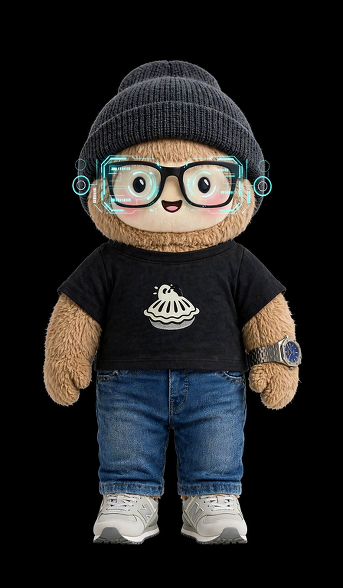

# Muse Life Size



Muse Life Size (the app is called **Muse Fullscreen**) is a small native Mac app
that shows your Muse call avatar in a free, see-through window of its own: no
frame, no background, any size, anywhere on the screen. It shows the live call
picture, so the avatar moves and talks as it does in Muse.

Not affiliated with or endorsed by Meta. "Muse" is the name of Meta's app; this
project only reads the call picture Muse already shows on your own Mac.

## Install

You need an Apple Silicon Mac with macOS 15.2 or later, and Muse.

1. Download **Muse-Fullscreen-2.1.zip** from the
   [latest release](https://github.com/rickndanger-ctrl/muse-life-size/releases/latest).
   It is signed and notarized by Apple, so it opens without warnings.
2. Double-click the zip and drag **Muse Fullscreen** into Applications. Open it.
3. The window walks you through two permissions, one button each:
   - **Screen Recording** lets it show Muse's call picture. Turn on
     Muse Fullscreen in the System Settings page that opens, then press
     **Reopen Muse Fullscreen** (macOS hands over the picture only after a restart).
   - **Accessibility** lets it find Muse's call window and press Muse's call
     buttons for you. Turn on Muse Fullscreen in the page that opens.
4. Start a call in Muse. The avatar appears by itself.

### Sharper picture: Muse's larger video

Muse draws its call video at a size it remembers. If the picture looks soft, give
Muse its largest size (the same as Muse's own "Make video window larger"), then
quit Muse with ⌘Q and open it again:

```
defaults write com.meta.endo endo_voice_call_pip_width -int 330
```

On one Mac this raised the picture from 182 x 311 to 332 x 568 pixels; on a Retina
MacBook, from 304 x 552 to 664 x 1136. This is Muse's own setting, so a Muse
update could change it.

## Use

1. Open **Muse Fullscreen.app** and start a call in Muse, in either order. The
   picture appears by itself.
2. Drag the picture to move it. Drag an edge to resize it; it keeps its shape.
   **Double-click** it to fill the screen height, and again to go back.
3. The three round buttons over the picture press Muse's own speaker, microphone
   and end-call controls.
4. **Escape** (after a click on the picture) hides it. **Enlarge Muse** in the menu
   bar, or a right-click on the picture, shows it again and holds the options and
   Quit.

It is not tied to Muse's window or to an OMAC page. OMAC does not manage it, so it
stays where it is when the page changes.

## What Muse allows, measured on a live call (2026-11-24)

These are Muse's rules, not this app's. They decide how sharp the picture is.

- Muse shows its **large avatar** (332 x 568 pixels of picture inside a 442 x 686
  window; its own "Make video window larger" stops there) only while Muse is the
  app you are using and its own window is open. That is the sharp source.
- In every other case (another app in use, another page, Muse's window minimized)
  Muse shows a **small call panel** instead, with the same avatar at about
  144 x 226 pixels. This app follows it, so the picture keeps going, but it is
  visibly softer when enlarged. Nothing can make Muse draw it larger.
- A click on this window does not take the keyboard from Muse. Opening the app
  does, so it hands the keyboard back to Muse half a second later, only when
  Muse's own window is open on this desktop.
- The capture keeps running at about 25 frames a second when the source window is
  covered, or slid off the screen edge with 40 points left on screen. It stops when
  the window is hidden, and resumes by itself.
- The white backdrop behind the avatar is part of Muse's picture. Everything
  around it is see-through.

**Move Muse's small avatar aside while showing** (menu, on by default) slides
Muse's large floating avatar to the right screen edge while the picture is showing
here, and puts it back when this window is hidden.

## Permissions

Screen Recording shows the avatar. Accessibility lets the buttons press Muse's
controls, finds the picture inside the avatar window, and moves the small avatar
aside. There is no recording, web server, camera, microphone or audio capture.
Audio stays in Muse. Nothing ends or starts a call by itself.

## Build from source

`./build.sh` needs the Xcode command-line tools (`xcode-select --install`) and
builds `Muse Fullscreen.app` in this folder. It signs with your Apple Development
or Developer ID certificate if you have one (or `MUSE_CODESIGN_IDENTITY`), and ad
hoc otherwise. With an ad hoc signature macOS asks for both permissions again
after every rebuild. `./release.sh` is the maintainer's notarized build.
Diagnostics (events and frame counts, never images) go to `~/Library/Logs/Muse Fullscreen/viewer.log`, wherever the app is kept.

## Checked, and not

Checked on a live call (earlier builds, same capture code): about 25 frames a
second from the large avatar; stop and resume across an OMAC page switch; the
microphone button; the small avatar moving aside and back.

Checked without a call (this build): the window is see-through and frameless;
OMAC writes no row for it and it stays in place across three page switches.

Checked on live calls (2.0, 2026-11-24, two Mac minis and a Retina MacBook): the
large avatar and the small call panel, with the panel's crop placed from Muse's
call buttons and its corners rounded like Muse's card.

Not checked yet: the double-click fill; more than one display; an Intel Mac
(not supported by the build).

## Artwork

`assets/` holds two high-resolution stills of the author's Muse avatar, made by
Muse: a full-body picture with a see-through background (2142 x 3672) and a
square portrait (3200 x 3200). They are artwork for this page. The app itself
always shows the live call picture.

## License

The code is MIT licensed (see `LICENSE`).
